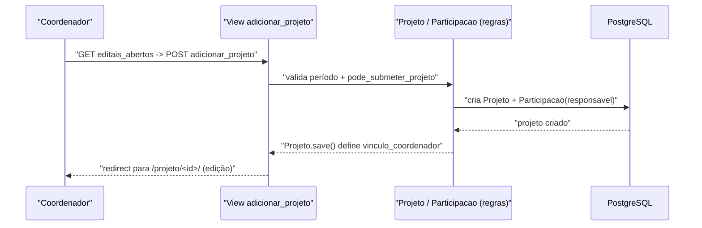

# Fluxo: Submeter projeto

> O coordenador cria um projeto em um edital aberto e monta sua proposta (equipe, metas/atividades, orçamento).

- **Ator(es):** Coordenador do projeto (servidor; ou aluno de graduação se `aluno_pode_submeter`) — ver [README → Atores e papéis](../README.md#atores-e-papéis)
- **Gatilho:** `POST /projetos_ensino/adicionar_projeto/<edital_id>/`
- **Pré-condições:** Edital em período de inscrição (`Edital.em_inscricao()`); `Edital.pode_submeter_projeto(vinculo)`; o vínculo ainda não é responsável por outro projeto pré-aprovado no mesmo edital (`get_editais_disponiveis`).
- **Pós-condições:** `Projeto` criado em estado "Em edição" (`STATUS_EM_INSCRICAO`), com o submissor como `Participacao(responsavel=True)`; `vinculo_coordenador` definido; equipe/metas/memória de cálculo/desembolso podem ser editados.
- **Depende de:** [Publicar edital](publicar-edital.md)
- **Habilita:** [Enviar projeto](enviar-projeto.md)
- **Entrada no código:** view `adicionar_projeto` (`views.py:1996`), `editais_abertos` (`views.py:589`)

## Sequência

## Observações

- O coordenador então cadastra equipe (`adicionar_participante_*`), metas/atividades (`adicionar_meta`/`adicionar_etapa`), memória de cálculo (`memoria_calculo`) e desembolso — todos editáveis enquanto `STATUS_EM_INSCRICAO`.
- Anexos exigidos por tipo de membro são gerados via `Participacao.gerar_anexos_do_participante`.
- > ⚠️ REVISAR: a elegibilidade exata (ex.: editais contínuos) depende de `get_status`/`get_periodo`, cuja lógica é extensa e ramificada por tipo de edital.

---
_Gerado/atualizado via subagent `documentador` em 2026-06-19._
