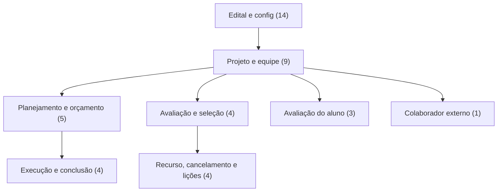

# Modelo de dados — Projetos de Ensino

> Módulo grande (44 models em um único `models.py`): o modelo está particionado por
> **subdomínio**. Como `projetos_ensino` usa um `models.py` único (não um pacote
> `models/`), o agrupamento foi inferido por **clusters de nome/relação** + o
> agrupamento do `admin.py`. ⚠️ REVISAR: a fronteira entre subdomínios é uma inferência;
> a entidade `Projeto` é o hub e aparece como entidade **externa** na maioria dos ERDs.
>
> Cada sub-área tem seu próprio ERD; este índice dá a visão macro e como as áreas se
> conectam. **Cobertura: 44/44 models, cada um em exatamente um ERD.**

## Subdomínios

| Subdomínio | Entidades principais | ERD |
|---|---|---|
| Edital e config (14) | Edital, Parametro, ParametroEdital, CriterioAvaliacao, OrigemRecursoEdital, Recurso, OfertaProjeto, EditalAnexo, EditalAnexoAuxiliar, EixoTematico, TipoBeneficiario, ComissaoEdital, ComissaoAcompanhamento, CampusAdicional | [edital-e-config.md](edital-e-config.md) |
| Projeto e equipe (9) | Projeto, Participacao, HistoricoEquipe, ProjetoAnexo, FotoProjeto, ProjetoHistoricoDeEnvio, HistoricoOrientacaoProjeto, HistoricoAlteracaoPeriodoProjeto, CaracterizacaoBeneficiario | [projeto-e-equipe.md](projeto-e-equipe.md) |
| Planejamento e orçamento (5) | Meta, Etapa, ItemMemoriaCalculo, Desembolso, ParametroProjeto | [planejamento-orcamento.md](planejamento-orcamento.md) |
| Execução e conclusão (4) | RegistroExecucaoEtapa, RegistroGasto, RegistroConclusaoProjeto, RegistroFrequencia | [execucao-conclusao.md](execucao-conclusao.md) |
| Avaliação e seleção (4) | Avaliacao, ItemAvaliacao, AvaliadorIndicado, AvaliadorExterno | [avaliacao-selecao.md](avaliacao-selecao.md) |
| Recurso, cancelamento e lições (4) | RecursoProjeto, ProjetoCancelado, LicaoAprendida, AreaLicaoAprendida | [recurso-cancelamento-licoes.md](recurso-cancelamento-licoes.md) |
| Avaliação do aluno (3) | AvaliacaoAluno, ItemAvaliacaoAluno, CriterioAvaliacaoAluno | [avaliacao-do-aluno.md](avaliacao-do-aluno.md) |
| Colaborador externo (1) | ColaboradorExterno | [colaborador-externo.md](colaborador-externo.md) |

> Nota: `TipoVinculo` (em `models.py`) **não** é um model — é uma classe utilitária com
> as constantes `BOLSISTA`/`VOLUNTARIO`, por isso não consta em nenhum ERD.

---
_Gerado/atualizado via subagent `documentador` em 2026-06-19._
