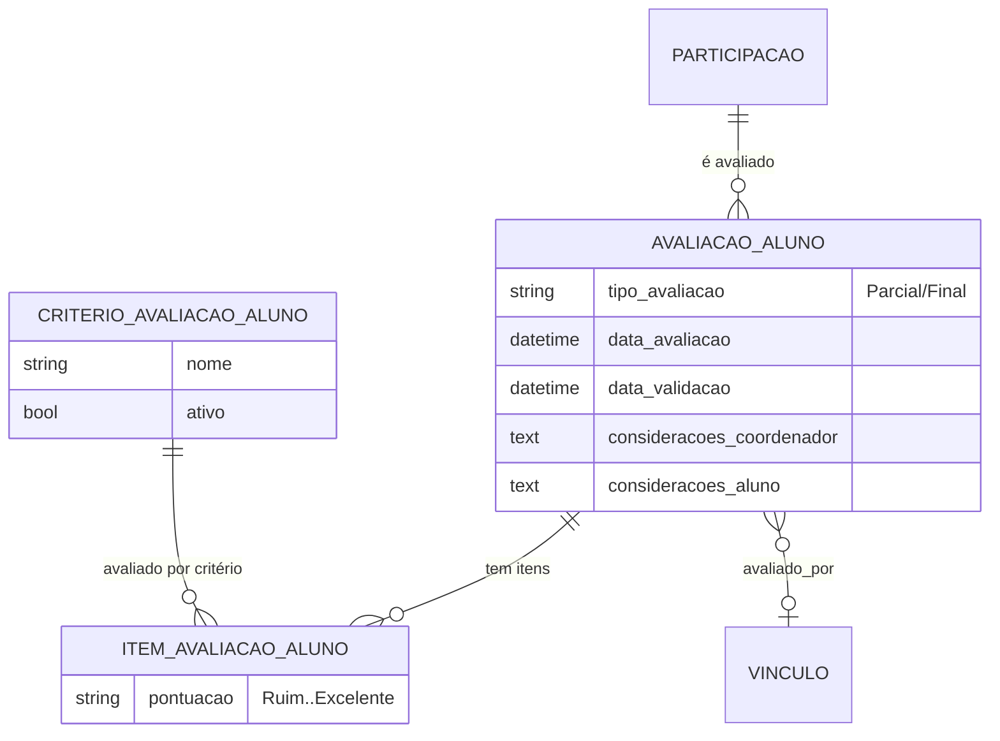

# Modelo de dados — Avaliação do aluno

> ERD da avaliação dos alunos bolsistas/voluntários pelo coordenador (quando o edital
> exige) — models herdam `ModelPlus` de `djtools.db`. FKs para outras sub-áreas
> aparecem como **externas**. Termos: ver Glossário (`../GLOSSARIO.md`).

## Entidades

| Entidade | Descrição | Relações-chave |
|---|---|---|
| `CriterioAvaliacaoAluno` | Cadastro de critério usado para avaliar o aluno (qualitativo). | — |
| `AvaliacaoAluno` | Avaliação (parcial ou final) de um participante; o aluno registra considerações. | FK `participacao` → `Participacao`, FK `vinculo_avaliado_por` → `comum.Vinculo` |
| `ItemAvaliacaoAluno` | Nota qualitativa (Ruim/Regular/Bom/Excelente/Não se Aplica) por critério dentro de uma avaliação. | FK `avaliacao` → `AvaliacaoAluno`, FK `criterio` → `CriterioAvaliacaoAluno` |

## Entidades externas referenciadas

| Entidade | Módulo/área de origem |
|---|---|
| `Participacao` | projetos_ensino (subdomínio [Projeto e equipe](projeto-e-equipe.md)) |
| `Vinculo` | comum |

---
_Gerado/atualizado via subagent `documentador` em 2026-06-19._
