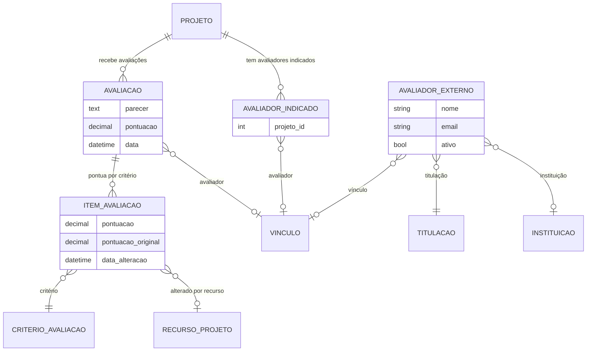

# Modelo de dados — Avaliação e seleção

> ERD da avaliação/seleção de projetos: indicação de avaliadores, avaliação por critério
> e a média de pontuação (models herdam `ModelPlus` de `djtools.db`). FKs para outras
> sub-áreas e módulos aparecem como **externas**. Termos: ver Glossário (`../GLOSSARIO.md`).

## Entidades

| Entidade | Descrição | Relações-chave |
|---|---|---|
| `AvaliadorIndicado` | Indicação de um avaliador (`comum.Vinculo`) a um projeto; expõe e-mail/telefone/Lattes resolvendo servidor ou avaliador externo. | FK `projeto` → `Projeto`, FK `vinculo` → `comum.Vinculo` |
| `Avaliacao` | Avaliação de um projeto por um avaliador (única por `projeto`+`vinculo`); recalcula a pontuação do projeto no `save`/`delete` (média quando há mais de uma avaliação). | FK `projeto`, FK `vinculo` → `comum.Vinculo` |
| `ItemAvaliacao` | Pontuação por critério dentro de uma avaliação; guarda pontuação original quando alterada via recurso. | FK `avaliacao` → `Avaliacao`, FK `criterio_avaliacao` → `CriterioAvaliacao`, FK `recurso` → `RecursoProjeto` |
| `AvaliadorExterno` | Avaliador externo cadastrado (nome, e-mail, titulação, instituição); ao salvar (de)associa o grupo "Avaliador de Projetos de Ensino" ao vínculo. | OneToOne `vinculo` → `comum.Vinculo`, FK `titulacao`/`instituicao_origem` → `rh` |

## Entidades externas referenciadas

| Entidade | Módulo/área de origem |
|---|---|
| `Projeto` | projetos_ensino (subdomínio [Projeto e equipe](projeto-e-equipe.md)) |
| `CriterioAvaliacao` | projetos_ensino (subdomínio [Edital e config](edital-e-config.md)) |
| `RecursoProjeto` | projetos_ensino (subdomínio [Recurso, cancelamento e lições](recurso-cancelamento-licoes.md)) |
| `Vinculo` | comum |
| `Titulacao`, `Instituicao` | rh |

---
_Gerado/atualizado via subagent `documentador` em 2026-06-19._
