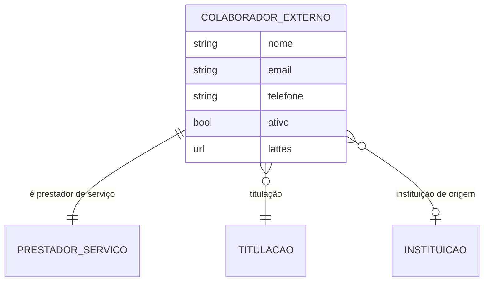

# Modelo de dados — Colaborador externo

> ERD do cadastro de colaborador externo (voluntário sem vínculo institucional ativo),
> usado como participante de projeto via `comum.PrestadorServico` — model herda
> `ModelPlus` de `djtools.db`. FKs externas marcadas. Termos: ver Glossário
> (`../GLOSSARIO.md`).

## Entidades

| Entidade | Descrição | Relações-chave |
|---|---|---|
| `ColaboradorExterno` | Colaborador voluntário externo (pessoa sem vínculo de servidor/aluno); participa do projeto via `PrestadorServico`. Tem documentação anexa e dados de titulação/instituição. | OneToOne `prestador` → `comum.PrestadorServico`, FK `titulacao`/`instituicao_origem` → `rh` |

## Entidades externas referenciadas

| Entidade | Módulo/área de origem |
|---|---|
| `PrestadorServico` | comum |
| `Titulacao`, `Instituicao` | rh |
| `Participacao` (consome o colaborador via `vinculo_pessoa`) | projetos_ensino (subdomínio [Projeto e equipe](projeto-e-equipe.md)) |

---
_Gerado/atualizado via subagent `documentador` em 2026-06-19._
