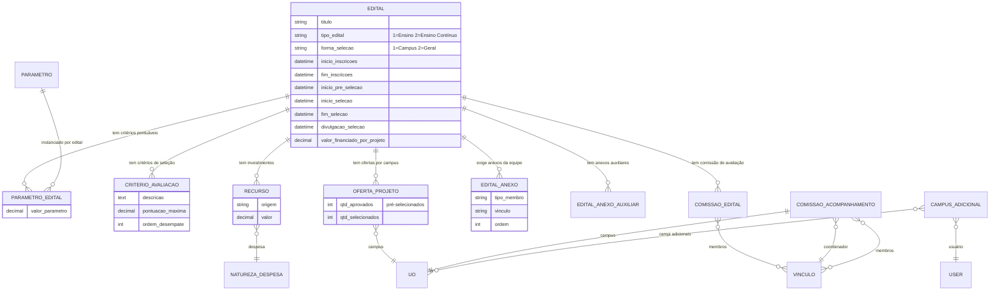

# Modelo de dados — Edital e configuração

> ERD das entidades de configuração do edital e cadastros de apoio (models herdam
> `ModelPlus` de `djtools.db`). FKs para entidades de outras áreas aparecem como
> **externas**. Termos: ver Glossário (`../GLOSSARIO.md`).

## Entidades

| Entidade | Descrição | Relações-chave |
|---|---|---|
| `Edital` | Edital que abre o processo de submissão; concentra o calendário (inscrição, pré-seleção, seleção, recurso, divulgação), tipo (`ENSINO`/`ENSINO_CONTINUO`), forma de seleção (`CAMPUS`/`GERAL`), termos de compromisso e regras (exige aluno, exige lições, etc.). | FK `cadastrado_por` → `comum.Vinculo`; manager `EditalManager` com filtros por período |
| `Parametro` | Critério pontuável reusável (`verbose_name` = "Critério"); agrupa pontuações configuráveis por edital. | — |
| `ParametroEdital` | Valor de um `Parametro` para um `Edital` específico. | FK `edital`, FK `parametro` |
| `CriterioAvaliacao` | Critério de seleção (qualificação) avaliado pelos avaliadores; tem pontuação máxima e ordem de desempate. | FK `edital` |
| `OrigemRecursoEdital` | Cadastro de origem de recurso financeiro do edital. | — |
| `Recurso` | Investimento financeiro disponível no edital (`verbose_name` = "Investimento") por despesa/origem (PROEX, DIGAE, CAMPUS). | FK `edital`, FK `despesa` → `financeiro.NaturezaDespesa` |
| `OfertaProjeto` | Oferta por campus (`verbose_name` = "Oferta de Projeto"): quantos projetos podem ser pré-selecionados/selecionados na UO. | FK `edital`, FK `uo` → `rh.UnidadeOrganizacional` |
| `EditalAnexo` | Tipo de documento exigido por tipo de membro/vínculo na submissão. | FK `edital` |
| `EditalAnexoAuxiliar` | Anexos auxiliares do edital (arquivos de apoio). | FK `edital` |
| `EixoTematico` | Eixo temático de classificação do projeto. | — |
| `TipoBeneficiario` | Cadastro de tipos de beneficiário do público-alvo. | — |
| `ComissaoEdital` | Comissão de avaliação de um edital. | FK `edital`, M2M `vinculos_membros` → `comum.Vinculo` |
| `ComissaoAcompanhamento` | Comissão de acompanhamento por campus. | OneToOne `uo`, FK `coordenador`, M2M `membros` → `comum.Vinculo` |
| `CampusAdicional` | Campi adicionais que um usuário (coordenador de projetos) pode operar além do seu. | FK `usuario` → `comum.User`, M2M `campus` → `rh.UnidadeOrganizacional` |

## Entidades externas referenciadas

| Entidade | Módulo/área de origem |
|---|---|
| `Vinculo` | comum |
| `User` | comum |
| `UnidadeOrganizacional` (UO) | rh |
| `NaturezaDespesa` | financeiro |
| `Projeto` | projetos_ensino (subdomínio [Projeto e equipe](projeto-e-equipe.md)) |

---
_Gerado/atualizado via subagent `documentador` em 2026-06-19._
