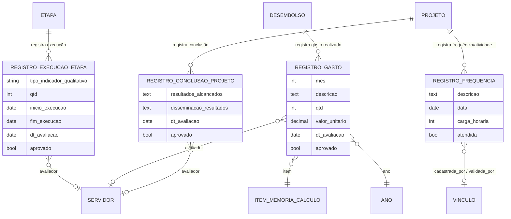

# Modelo de dados — Execução e conclusão

> ERD dos registros de execução e prestação de contas durante a fase de execução
> do projeto (models herdam `ModelPlus` de `djtools.db`). FKs para outras sub-áreas
> e módulos aparecem como **externas**. Termos: ver Glossário (`../GLOSSARIO.md`).

## Entidades

| Entidade | Descrição | Relações-chave |
|---|---|---|
| `RegistroExecucaoEtapa` | Registro de execução de uma atividade (`verbose_name` = "Registro de Execução de Atividade"): quantidade realizada, período real, indicador qualitativo e avaliação do monitor. | FK `etapa` → `Etapa`, FK `avaliador` → `rh.Servidor` |
| `RegistroGasto` | Registro de um gasto realizado em um desembolso: quantidade, valor, comprovante, termo de cessão e avaliação do monitor. | FK `item` → `ItemMemoriaCalculo`, FK `desembolso` → `Desembolso`, FK `ano`, FK `avaliador` → `rh.Servidor` |
| `RegistroConclusaoProjeto` | Registro de conclusão do projeto: resultados, disseminação, avaliação final do monitor. | FK `projeto` → `Projeto`, FK `avaliador` → `rh.Servidor` |
| `RegistroFrequencia` | Registro de frequência/atividade do aluno bolsista, com validação pelo coordenador. | FK `projeto` → `Projeto`, FK `cadastrada_por`/`validada_por` → `comum.Vinculo` |

## Entidades externas referenciadas

| Entidade | Módulo/área de origem |
|---|---|
| `Etapa`, `Desembolso`, `ItemMemoriaCalculo` | projetos_ensino (subdomínio [Planejamento e orçamento](planejamento-orcamento.md)) |
| `Projeto` | projetos_ensino (subdomínio [Projeto e equipe](projeto-e-equipe.md)) |
| `Servidor` | rh |
| `Vinculo`, `Ano` | comum |

---
_Gerado/atualizado via subagent `documentador` em 2026-06-19._
