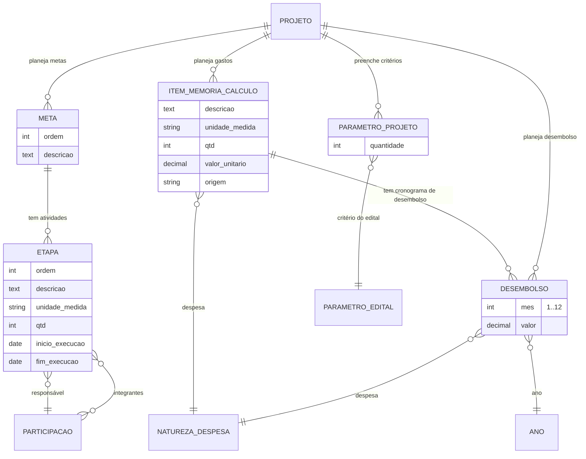

# Modelo de dados — Planejamento e orçamento

> ERD do planejamento do projeto: metas/atividades e a memória de cálculo / cronograma
> de desembolso (models herdam `ModelPlus` de `djtools.db`). FKs para outras sub-áreas
> e módulos aparecem como **externas**. Termos: ver Glossário (`../GLOSSARIO.md`).

## Entidades

| Entidade | Descrição | Relações-chave |
|---|---|---|
| `Meta` | Meta do projeto (`verbose_name` = "Meta"); agrupa atividades. | FK `projeto` → `Projeto` |
| `Etapa` | Atividade da meta (`verbose_name` = "Atividade"); tem responsável, integrantes, período planejado e indicadores. Valida `inicio <= fim` no `clean`. | FK `meta` → `Meta`, FK `responsavel` → `Participacao`, M2M `integrantes` → `Participacao` |
| `ItemMemoriaCalculo` | Item planejado de gasto (memória de cálculo): despesa, quantidade, valor unitário, origem. | FK `projeto`, FK `despesa` → `financeiro.NaturezaDespesa` |
| `Desembolso` | Parcela mensal planejada de um item de memória de cálculo (mês 1..12 do projeto). | FK `projeto`, FK `item` → `ItemMemoriaCalculo`, FK `despesa`, FK `ano` → `comum.Ano` |
| `ParametroProjeto` | Quantidade informada pelo projeto para um critério pontuável do edital (gera pontuação `quantidade × valor`). | FK `projeto`, FK `parametro_edital` → `ParametroEdital` |

A função módulo-nível `eh_planejamento(obj)` (em `models.py`) classifica `Meta`,
`Desembolso`, `ItemMemoriaCalculo` e `Etapa` como "planejamento" conforme a fase do edital,
controlando se ainda podem ser editados/removidos.

## Entidades externas referenciadas

| Entidade | Módulo/área de origem |
|---|---|
| `Projeto`, `Participacao` | projetos_ensino (subdomínio [Projeto e equipe](projeto-e-equipe.md)) |
| `ParametroEdital` | projetos_ensino (subdomínio [Edital e config](edital-e-config.md)) |
| `NaturezaDespesa` | financeiro |
| `Ano` | comum |

---
_Gerado/atualizado via subagent `documentador` em 2026-06-19._
