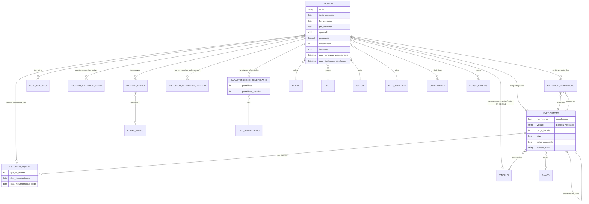

# Modelo de dados — Projeto e equipe

> ERD do `Projeto` (entidade central) e dos models de equipe/histórico ligados a ele
> (models herdam `ModelPlus` de `djtools.db`). FKs para outras sub-áreas e módulos
> aparecem como **externas**. Termos: ver Glossário (`../GLOSSARIO.md`).

## Entidades

| Entidade | Descrição | Relações-chave |
|---|---|---|
| `Projeto` | Entidade central. Concentra a máquina de estados (`get_status`/`get_periodo`), submissão, pré-seleção (`pre_aprovado`), seleção (`aprovado`, `pontuacao`, `classificacao`), execução e conclusão. Regras de negócio nos métodos `pode_*`. | FK `edital`, `uo`, `setor`, `eixo_tematico`; FK `vinculo_coordenador`/`vinculo_monitor`/`vinculo_autor_pre_avaliacao` → `comum.Vinculo`; M2M `componentes`/`cursos`/`disciplinas` → `edu` |
| `Participacao` | Vínculo de uma pessoa (aluno, servidor, colaborador) à equipe do projeto, com função (`responsavel`=coordenador), tipo (`Bolsista`/`Voluntário`), carga horária e dados bancários. | FK `projeto`, FK `vinculo_pessoa` → `comum.Vinculo`, FK `orientador` (auto), FK `instituicao` → `rh.Banco` |
| `HistoricoEquipe` | Histórico de movimentações de um participante (inserção, inativação, troca de coordenação, concessão de bolsa). | FK `projeto`, FK `participante` → `Participacao` |
| `ProjetoAnexo` | Anexo do projeto, podendo estar vinculado a um tipo exigido pelo edital e a um membro da equipe. | FK `projeto`, FK `anexo_edital` → `EditalAnexo`, FK `vinculo_membro_equipe`, FK `participacao` |
| `FotoProjeto` | Foto da execução (gera thumbnail via PIL no `save`). | FK `projeto` |
| `ProjetoHistoricoDeEnvio` | Registro das operações de envio/devolução/reabertura/finalização do projeto. | FK `projeto`, FK `operador` → `rh.Servidor`, FK `vinculo_operador` |
| `HistoricoOrientacaoProjeto` | Relação orientador↔orientado ao longo do tempo. | FK `projeto`, FK `orientado`/`orientador` → `Participacao` |
| `HistoricoAlteracaoPeriodoProjeto` | Registro de alterações no período de execução do projeto. | FK `projeto`, FK `vinculo_registrado_por` |
| `CaracterizacaoBeneficiario` | Quantidade prevista/atendida de beneficiários por tipo. | FK `projeto`, FK `tipo_beneficiario` → `TipoBeneficiario` |

## Entidades externas referenciadas

| Entidade | Módulo/área de origem |
|---|---|
| `Edital`, `EixoTematico`, `EditalAnexo`, `TipoBeneficiario` | projetos_ensino (subdomínio [Edital e config](edital-e-config.md)) |
| `Vinculo` | comum |
| `Setor` | comum |
| `UnidadeOrganizacional` (UO), `Servidor`, `Banco` | rh |
| `Componente`, `CursoCampus`, `Disciplina` | edu |

---
_Gerado/atualizado via subagent `documentador` em 2026-06-19._
