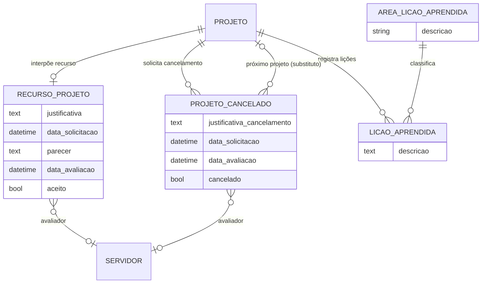

# Modelo de dados — Recurso, cancelamento e lições

> ERD dos fluxos pós-resultado e de encerramento: interposição de recurso, cancelamento
> de projeto e lições aprendidas (models herdam `ModelPlus` de `djtools.db`). FKs para
> outras sub-áreas e módulos aparecem como **externas**. Termos: ver Glossário
> (`../GLOSSARIO.md`).

## Entidades

| Entidade | Descrição | Relações-chave |
|---|---|---|
| `RecursoProjeto` | Interposição/apelação do coordenador contra o resultado da seleção (`verbose_name` = "Recurso"); um por projeto. Avaliado por servidor (aceito/não aceito + parecer). | OneToOne `projeto` → `Projeto`, FK `avaliador` → `rh.Servidor` |
| `ProjetoCancelado` | Solicitação de cancelamento de um projeto em execução; ao ser aceita pode indicar o `proximo_projeto` que assume a vaga (selecionado fora do prazo). | FK `projeto`, FK `proximo_projeto` → `Projeto`, FK `avaliador` → `rh.Servidor` |
| `LicaoAprendida` | Lição aprendida registrada na conclusão (quando o edital exige). | FK `projeto`, FK `area_licao_aprendida` → `AreaLicaoAprendida` |
| `AreaLicaoAprendida` | Cadastro de áreas para classificar lições aprendidas. | — |

> ⚠️ REVISAR: `RecursoProjeto` ("interposição/apelação") **não** é o mesmo conceito que
> `Recurso` ("investimento financeiro", subdomínio Edital e config). Ver Glossário.

## Entidades externas referenciadas

| Entidade | Módulo/área de origem |
|---|---|
| `Projeto` | projetos_ensino (subdomínio [Projeto e equipe](projeto-e-equipe.md)) |
| `Servidor` | rh |

---
_Gerado/atualizado via subagent `documentador` em 2026-06-19._
